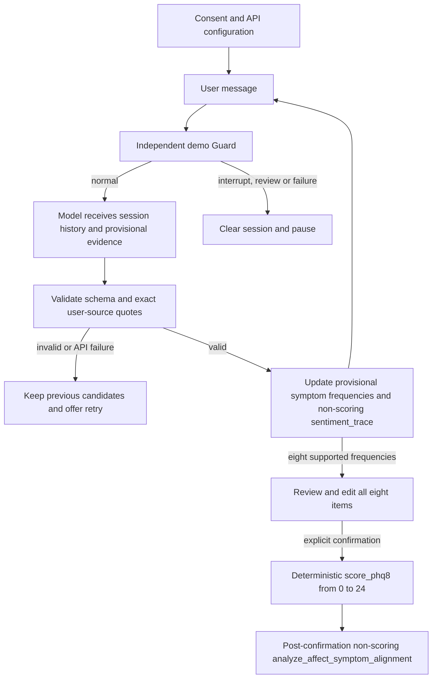

# Current system architecture

The default application is an English and Traditional Chinese conversational research prototype. It collects PHQ-8-informed symptom frequencies from fictional conversations, then asks the user to review all eight items before scoring.

## Modules and boundaries

| Module | Responsibility |
|---|---|
| `app.py` | Consent, session UI, bilingual chat, non-scoring `sentiment_trace` sidebar summary, review, edits, result display and post-confirmation quadrant observation. |
| `conversation.py` | CHAT / REVIEW / RESULT / PAUSED states, proposals, quote validation, retries, confirmation, turn-level `sentiment_trace` and post-confirmation `analyze_affect_symptom_alignment(state)`. |
| `bilingual_provider.py`, `localization.py` | Model language instructions and translated UI copy. Existing quotes and messages keep their original language. |
| `terra_client.py` | Compatible Responses API transport and structured output. The endpoint reports the model identity. |
| `safety_guard.py` | Demonstration marker guard only; normal-language crisis detection is not implemented. |
| `phq8_engine.py` | Strict validation and sum (`score_phq8`) of eight user-confirmed 0–3 frequencies, strictly invariant to affect polarity. |
| `research/dual_channel_s1/` | Unified Semester 1 Dual-Channel evaluation package (`benchmarks.py`, `run_experiments.py`, `plot_figures.py`). |

The model proposes item ID, frequency (0–3 or null), timeframe, exact quote, source turn and summary. It can update several domains in one turn. Quotes must exist in user messages; this validates provenance, not semantic correctness. Ambiguous or retracted answers remain unresolved. A new message exits review, and confirmation must match the current revision. Sentiment is a separate label and is never read by the score engine.

On every validated chat turn, `conversation.py` records `{"turn_id": user_turn_id, "sentiment": payload["sentiment"]}` in `state.sentiment_trace`. After explicit confirmation produces a `RESULT` state via `score_phq8`, `analyze_affect_symptom_alignment(state)` compares the turn-level negative-polarity ratio against whether the confirmed PHQ-8 total is at least 10, returning one of four non-scoring research quadrants (`congruent_low`, `situational_distress`, `masked_somatic`, `congruent_elevated`, or `unconfirmed_or_unclear` before confirmation / when no scored affect turns exist). `app.py` surfaces live non-scoring affect counts in the sidebar and displays the post-confirmation quadrant note on the result view. `score_phq8` reads only the eight confirmed integer item values (0–3) and remains strictly invariant to `sentiment` and `sentiment_trace`. `safety_guard.py` runs before any API call as a demonstration marker guard only (never a crisis detector), clearing messages, candidates and `sentiment_trace` on any non-normal return or guard exception.

Chat history and candidates live in the current Streamlit session and are sent to the configured endpoint on each model call. The app does not write chats to disk. Clearing or Guard interruption removes the history and candidates. API failures retain the pending user message for retry without duplicating it. The 40-turn cap stops additional model calls while allowing a complete existing summary to be reviewed; incomplete summaries require a new session.

## Retained comparison baseline

`questionnaire_app.py` uses `controller.py`, `nlu_provider.py`, `evidence_manager.py`, `rule_nlu.py` and `schemas.py` for the earlier per-item flow. It can run offline. Its structured NLU contract is in [nlp_contract.md](nlp_contract.md). [requirements.md](requirements.md) contains the dated baseline traceability matrix plus the current chat mapping. The parser diagnostic depends on these modules; they are not unused copies of the chat implementation.

## Research scope

The executed studies are the TweetEval benchmark, 64-case rule diagnostic and 48-request bilingual sentiment pilot. Independent multi-turn accuracy, clinical validity, validated bilingual administration and real crisis handling remain unestablished. See [recorded evidence](docs/evidence/semester1/README.md), [chat verification](docs/evidence/bilingual/verification.md) and the [report](docs/report/Group_T_Semester_1_Final_Report.pdf).

The unified Semester 1 Dual-Channel evaluation package under `research/dual_channel_s1/` organizes reproducible offline and connected experiments across four modules and stages:

- `benchmarks.py`: constructs author-designed bilingual diagnostic suites and simulation cohorts with explicit provenance boundaries—48-case 4-quadrant affect-vs-PHQ-8 divergence cases (E1B), 64 held-out symptom extraction and selective-abstention turns paired with a SHA-256-disjoint 320-utterance training corpus (E2), 240 stratified 8-turn partial-observation sessions (E3), and 32 bilingual dialogue personas plus four fictional multi-turn session scripts (E4).
- `run_experiments.py`: runs E1–E4 end to end (TweetEval classical ML baselines plus 4-quadrant divergence, bilingual symptom extraction and selective-abstention risk-coverage analysis, partial-observation triage at `k = 2, 4, 6`, P0/P1/P2 dialogue policy simulation, optional live endpoint runs, and deterministic audits verifying `score_phq8` affect invariance, exact-quote schema rejection, and pre-API demonstration marker guard clearing).
- `plot_figures.py`: generates summary figures from the JSON artifacts written by `run_experiments.py`.

Apart from public TweetEval splits, all `research/dual_channel_s1/` cohorts are author-constructed diagnostic benchmarks and controlled simulations on fictional cases; they do not establish clinical validity or crisis detection.
