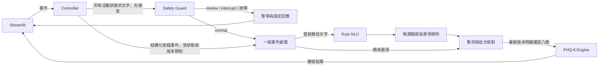

# 系統架構與模組介面

專案核准題目 **Sentiment Analysis for Depression Detection**。依據 Master Plan V3.1（本機原檔 `FYP_Research_and_Implementation_Master_Plan_V3_1.docx`） §IV–V、§VII–VIII、§X–XII。本文是 WP01 的提案，涵蓋 WP03／04／05／06 的接口與行為。

## 架構審查

| 發現與依據 | 風險與設計決定 |
|---|---|
| §IV-B 要求 Safety Guard 優先。圖 1 從 FSM 分叉到 Guard 和 NLU，未畫出阻斷條件。 | Controller 在每個收到自由文字的活動狀態先呼叫 Guard，取得 `normal` 才進入一般事件處理、NLU 或評分。即使文字與題目無關或事件已過期，仍先檢查。 |
| 圖 1 把 sentiment 接入 Evidence Manager，但 §IV-B/C 只允許研究特徵及可選輔助。 | 本期移出對話依賴鏈。證據判定只讀結構化症狀候選及當前題目。Sentiment 可以缺席、失效或變更而不影響任何答案或分數。 |
| WP01 寫「七大狀態」，圖 2 有八個框，§IV-C 另有 `END`。圖示把澄清畫成必經路徑，且編輯只畫回 `SCREENING`。表中同時使用 `REVIEW` 與 `BATCH_REVIEW`。 | 提案採九個明確狀態。澄清為條件路徑，編輯返回原狀態，統一 `BATCH_REVIEW` 命名。若需保留七個狀態，須更新建模與驗收規格。 |
| §IV-C 未定義確認快照、過期事件、編輯撤銷、重複事件及結果後操作。 | 控制器擁有狀態與單調遞增的版本。確認綁定畫面版本與暫存集合。結果頁停止接受問卷文字與編輯，重做從新會話開始。 |
| §IV-B／E 定義 `review`，但沒有第一期的處理及 Guard 故障路徑。§XII D04 另列 Guard，§VIII 未分配獨立 WP。 | 在 WP04 定義 Guard 與優先順序，在 WP06 驗收呈現。提案將 `review`、`interrupt` 和故障均映射至阻斷狀態，但各自顯示適當的固定文案。完整語義偵測與 FMEA 留待後續。 |
| §IV-C 未定稿可接受時間窗、有限詞彙、矛盾優先序和 confidence 的門檻。 | WP05 採確定性規則。硬性條件先檢查時間、題目、矛盾及格式。無法可靠解析時，請用戶針對過去兩週直接選頻率。 |
| §V-B 列測試類別，部分情境缺少可執行的預期結果。§VIII-D 提及真實模型整合，§XI 容許 Mock。 | 補上固定輸入、判定及驗證紀錄。第一期依賴本地規則與合成 fixtures。組員的 API 屬後續可替換介面，無需等待資料授權、模型或網路。 |
| §IV-B 只寫「預設不持久化」，未列 Streamlit 重跑、日誌與分頁的資料邊界。 | 只在該 Streamlit 會話記憶體保留必要狀態。自由文字只在單次事件處理時使用，提交後移除輸入 widget 值。兩個會話互相隔離。 |

已查看 V3.1 文字、表格及兩張內嵌圖。初始工作目錄只有 Word 文件，`git rev-parse` 無有效工作樹，已連接 GitHub 的可見 repo 未見本 FYP。原始碼、既有接口、依賴版本與測試基線皆未核對。下列檔名依 V3.1 規劃，取得 repo 後應沿用其等效入口。

## 資料流

## 模組介面

| 模組與擁有人 | 提案接口 | 輸入、輸出與錯誤語意 |
|---|---|---|
| `schemas.py`（WP01） | `validate_nlu(payload: Mapping[str, object], expected_item: int) -> NluResult` | 共用型別如下。非法結構或錯題拋 `ValueError`，控制器轉結構化選項回退。反序列化與評分邊界均需驗證。 |
| `phq8_engine.py`（WP03） | `score_phq8(confirmed: Sequence[ConfirmedAnswer]) -> Phq8Result` | 純函式。要求恰好八個唯一且完整的題號 1–8，分值為 0–3 的嚴格整數。缺漏、重複、額外題、未確認型別或非法值均拋 `ValueError`，無部分結果。 |
| `safety_guard.py`（WP04） | `check_safety(text: str) -> SafetyDecision` | 本地受審規則回傳 `normal / review / interrupt`。回傳值非法或呼叫失敗，由 Controller 以 Guard 故障處理。轉移碼分別為 `safety_review / safety_interrupt / safety_unavailable`，由 UI 選取固定回應，避免回顯文字。 |
| `controller.py`（WP04） | `new_session() -> SessionState`、`dispatch(state: SessionState, event: Event) -> Transition` | 單一轉移入口，外部 Guard 與 NLU 可用替身注入。先處理安全，再驗證會話、版本、事件與題號，最後處理狀態。回傳新快照、畫面回應碼與不含文字的轉移摘要。非法事件保留原狀，回傳拒絕碼。 |
| `rule_nlu.py`（WP05） | `extract(item_id: int, text: str) -> NluResult` | 只解析指定題目。清楚且符合兩週的頻率可回候選分值。詞彙範圍外、模糊、矛盾、時間缺失時必須拒答。 |
| Evidence Manager（WP04／05） | `decide_candidate(result: NluResult) -> Decision` | 放在 Controller 的小型純規則。只允許當前題目、對應過去兩週、無衝突且合規的分值成為暫存候選。其他輸出均導向有原因碼的澄清，`confidence_signal` 只作診斷。 |
| `app.py`（WP06） | `streamlit run app.py` | 將文字或操作送到 `dispatch`，以 `st.session_state` 保存最新快照，根據狀態呈現 consent、題目、澄清、核對、結果或中斷文案。表單提交才送事件，顯示重跑不重送。畫面不得直接寫入答案、判斷危機或計分。 |

資料型別與 JSON 邊界規格（WP01）

- `NluResult` 為 JSON object。必需欄位為 `item_id`（1–8）、`frequency_candidate`（0–3 或 null）、`timeframe`（`past_14_days / missing / other / unclear`）、`symptom_present`（true／false／null）、`negation`（`none / clear / unclear`）、`ambiguity`（`none / ambiguous_frequency / uncertain / contradiction / off_topic`）、`model_version`（非空字串）。選填 `confidence_signal`（null 或 [0, 1] 有限數值）。拒絕未宣告欄位、字串數字、浮點分值、布林分值及錯題。合法格式但不合證據規則的輸出依然進澄清。對已知題目及兩週的整段明確否定才可提出 0，未提到症狀不能推得 0。
- `Event` 含 `kind`、`session_id`、畫面產生時的 `expected_revision`，以及事件專屬 payload。操作為 `START / ACCEPT / DECLINE / TEXT / SELECT / EDIT / CANCEL_EDIT / CONFIRM / CANCEL / RESET`。`TEXT` 包含單一字串及可空目標題號，正常作答仍須匹配當前題或編輯目標。`SELECT` 帶目標題號與 0–3 整數，`EDIT` 帶目標題號，其餘操作沒有 payload。確認事件不從客戶端接受分值。會話 ID、版本和 widget key 在建立畫面時綁定。由伺服器當前 Streamlit 會話決定送到哪份狀態，無法藉事件選擇其他會話。
- `SessionState` 含會話 ID、狀態、版本、當前題、編輯目標及返回狀態／題目、`provisional_answers`（題號對分值）、`confirmed_answers`（一批不可變 `ConfirmedAnswer(item_id, value)`）、`safety_state` 與可空的 `result`。缺答以缺少題號表示。每題只留一份暫存。原始文字只隨當次 `Event` 傳遞，無需進 SessionState。
- `Transition` 含新版 `SessionState`、`response_code` 及安全的摘要（前後狀態、事件種類、題號、版本與決策原因碼）。`Phq8Result` 含 `total`（0–24）及 `band`（按 0–4、5–9、10–14、15–19、20–24 分類）。畫面用「症狀程度」表達，確切本地化文案待確認。控制器只有在確認成功時建立 `ConfirmedAnswer`。分段依據見 [Kroenke 等原始 PHQ-8 研究](https://pubmed.ncbi.nlm.nih.gov/18752852/)及 [PHQ-8 Days 研究](https://pmc.ncbi.nlm.nih.gov/articles/PMC3108293/)。

## 狀態及全域規則

| 起點 | 合法事件與轉移 |
|---|---|
| `START` | `START` → `CONSENT`，顯示研究用途。 |
| `CONSENT` | `ACCEPT` → `SCREENING` 第 1 題。 `DECLINE` → `END` 並清空。 |
| `SCREENING` | 合規作答 → 暫存當前題，前往下一未答題。八項齊備 → `BATCH_REVIEW`。未能解析 → `CLARIFICATION` 同題。 `EDIT` 只接受已有暫存的題目。 |
| `CLARIFICATION` | 有效作答依同一規則暫存並前進。再次含糊或模型故障，留同題並提供四個有明確兩週題幹的標準選項。 |
| `BATCH_REVIEW` | 顯示八項按題排序的暫存答案。 `EDIT` → `EDIT_ANSWER`。 `CONFIRM` 僅接受當前快照及完整八題，先從該快照生成確認集合並計分，成功才一次更新到 `RESULT`。 |
| `EDIT_ANSWER` | 成功替換選定題後，返回原狀態及原題。修改內容未能解析時，留在編輯並保留原暫存。 `CANCEL_EDIT` 返回原狀態並保留原值。進出編輯均推進版本，過期核對不可繼續用。 |
| `SAFETY_FLOW` | 清除問卷資料與結果，停發一般對話。只允許 `CANCEL` 結束，或 `RESET` 建立新的 `START` 會話。 |
| `RESULT`、`END` | 終止狀態。 `RESET` 用新 ID 重新開始，舊畫面事件不再有效。 `RESULT` 也可用 `CANCEL` 清空並結束。 |

- 活動狀態為 `START / CONSENT / SCREENING / CLARIFICATION / EDIT_ANSWER / BATCH_REVIEW`。每筆由當前會話送入的 `TEXT` 先過 Guard，即使來源不是當前題目。非 `normal` 立即中斷，本次不呼叫 NLU、不前進、不計分。終止畫面不接受文字。 `CANCEL` 會清空活動中的問卷並進入 `END`。
- 除優先安全轉移外，過期版本、錯誤會話、重複提交與非法跳轉不改狀態。每次接受的操作推進版本，重跑只呈現現有狀態。已成功進入結果的確認事件重送時，不重新計分。
- 候選與評分分離。 `TEXT` 和 `SELECT` 都只產生暫存。編輯後的最終確認重新生成八個確認值並只以最新版本計分。計分驗證若意外失敗，保留核對狀態並提供錯誤訊息，無確認集合或結果提交。
- 四個標準頻率的意義依次為完全沒有（0）、有幾天（1）、超過一半的日子（2）、幾乎每天（3）。正式翻譯由團隊確認。選項事件的兩週時間窗來自畫面題幹。文字規則只接受已定義措辭且有明確兩週證據的回答。無單位的數字、模糊頻率與相互衝突的頻率一律交澄清。
- UI 與測試採虛構資料。原始文字不進持久化、共享快取、日誌、截圖或第三方服務。畫面可使用通過審查且版本固定的支援文案。純合成測試可暫用顯著標記的文案替身。
