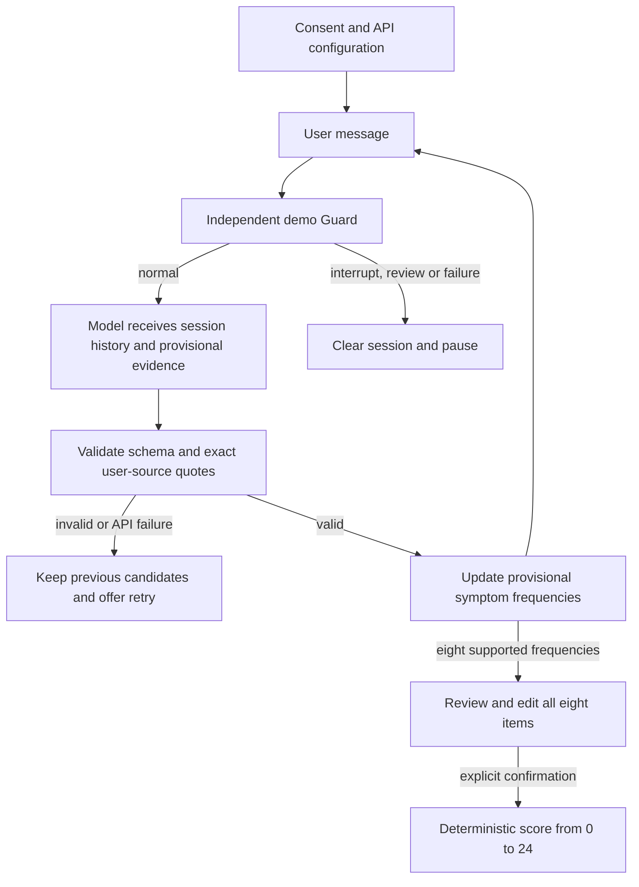

# Current system architecture

The default application is an English and Traditional Chinese conversational research prototype. It collects PHQ-8-informed symptom frequencies from fictional conversations, then asks the user to review all eight items before scoring.

## Modules and boundaries

| Module | Responsibility |
|---|---|
| `app.py` | Consent, session UI, bilingual chat, review, edits and result display. |
| `conversation.py` | CHAT / REVIEW / RESULT / PAUSED states, proposals, quote validation, retries and confirmation. |
| `bilingual_provider.py`, `localization.py` | Model language instructions and translated UI copy. Existing quotes and messages keep their original language. |
| `terra_client.py` | Compatible Responses API transport and structured output. The endpoint reports the model identity. |
| `safety_guard.py` | Demo marker Guard; normal language crisis detection is not implemented. |
| `phq8_engine.py` | Strict validation and sum of eight user-confirmed frequencies. |

The model proposes item ID, frequency (0–3 or null), timeframe, exact quote, source turn and summary. It can update several domains in one turn. Quotes must exist in user messages; this validates provenance, not semantic correctness. Ambiguous or retracted answers remain unresolved. A new message exits review, and confirmation must match the current revision. Sentiment is a separate label and is never read by the score engine.

Chat history and candidates live in the current Streamlit session and are sent to the configured endpoint on each model call. The app does not write chats to disk. Clearing or Guard interruption removes the history and candidates. API failures retain the pending user message for retry without duplicating it. The 40-turn cap stops additional model calls while allowing a complete existing summary to be reviewed; incomplete summaries require a new session.

## Retained comparison baseline

`questionnaire_app.py` uses `controller.py`, `nlu_provider.py`, `evidence_manager.py`, `rule_nlu.py` and `schemas.py` for the earlier per-item flow. It can run offline. Its structured NLU contract is in [nlp_contract.md](nlp_contract.md). [requirements.md](requirements.md) contains the dated baseline traceability matrix plus the current chat mapping. The parser diagnostic depends on these modules; they are not unused copies of the chat implementation.

## Research scope

The executed studies are the TweetEval benchmark, 64-case rule diagnostic and 48-request bilingual sentiment pilot. Independent multi-turn accuracy, clinical validity, validated bilingual administration and real crisis handling remain unestablished. See [recorded evidence](docs/evidence/semester1/README.md), [chat verification](docs/evidence/bilingual/verification.md) and the [report](docs/report/Group_T_Semester_1_Final_Report.pdf).
