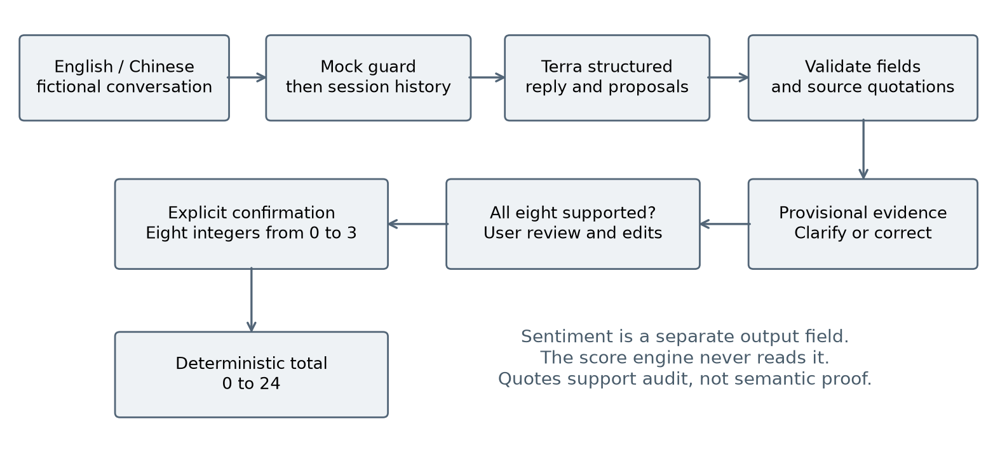
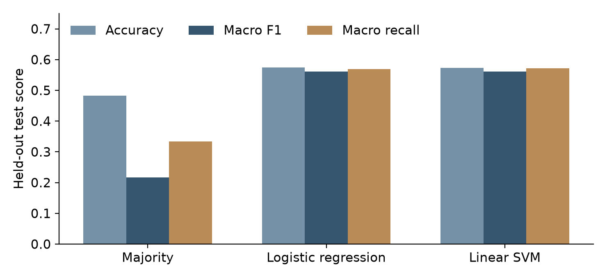
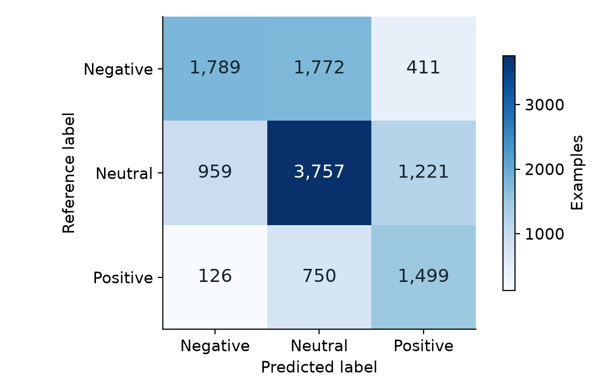
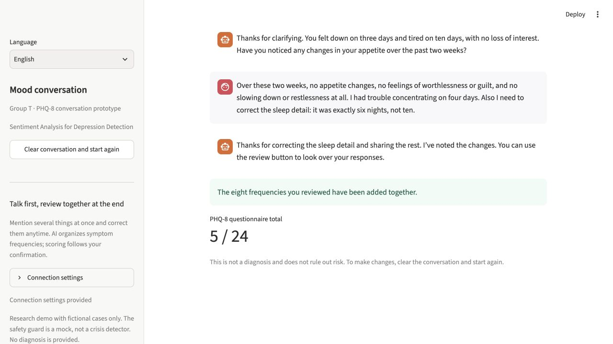

# Sentiment Analysis for Depression Detection
## Semester 1 Final Report
Group T · CHAN Kin Long and LEE Ka Tung · 26 November 2026

### Abstract
This project investigates how sentiment analysis can be incorporated into a conversational questionnaire without treating emotional polarity as a depression diagnosis or as a substitute for symptom-frequency evidence. The first-semester system combines a three-class sentiment component with an English and Traditional Chinese PHQ-8-informed response-collection interface. A deterministic controller separates provisional interpretation, review, explicit confirmation and scoring. We evaluated a majority baseline, TF-IDF with logistic regression and TF-IDF with a linear support vector machine on the official TweetEval sentiment splits. The validation-selected SVM achieved a test macro-F1 of 0.561 and macro recall of 0.571; the majority baseline achieved 0.217 and 0.333 respectively. A separate 64-case, AI-authored diagnostic exercise found that the context-aware rule parser made no accepted-candidate errors on those cases, but accepted only 24 of 64 inputs and rejected eight resolvable natural-language answers. GPT-6.1 Terra was additionally evaluated through a configured third-party compatible gateway on 48 bilingual, authored sentiment examples. These small diagnostic exercises are exploratory and do not estimate population-level performance. The current interface supports multi-turn natural conversation, evidence-linked symptom proposals and corrections before final review. The original rule-based questionnaire remains available as a baseline. The score engine reads only eight user-confirmed frequencies. The new conversational extractor has functional verification but no independently annotated accuracy evaluation. The resulting contribution is a reproducible engineering and evaluation baseline, with explicit limitations concerning language transfer, synthetic evaluation, questionnaire wording and crisis handling. No clinical validity or therapeutic benefit is claimed.

### 1 Introduction
The approved project title provides a broad motivation: understanding the relationship between language, sentiment and depression-related screening. The work completed this semester addresses a narrower, testable problem. A person can express negative emotion without specifying how often a symptom occurred. Conversely, a factual statement about sleep or energy may contain useful frequency information without strongly negative wording. A polarity label and a questionnaire answer therefore represent different constructs.

PHQ-8 research provides a structured framework for collecting eight symptom-frequency responses over the preceding two weeks [1,2]. Conversational input introduces an additional interpretation step: words such as “sometimes,” negation and inconsistent time references can prevent a unique mapping to a response category. The system must expose that uncertainty instead of silently filling a score.

The intended outcome is a research demonstrator for fictional conversations, with an independently measurable sentiment model and an auditable response-collection flow. This semester emphasizes reproducible experiments and controlled software behavior. Evaluation of real users, clinical outcomes and depression-label prediction requires different evidence and remains outside the completed work.

<!-- page -->
## 2 Literature review and research position
### 2.1 Symptom measurement and day-count responses
Kroenke et al. [1] examined PHQ-8 definitions in a population-based telephone survey of 198,678 respondents. The indexed abstract reports broadly similar prevalence under a questionnaire algorithm and a score threshold, but also identifies the absence of an independent structured psychiatric interview as a limitation of its criterion standard. We consulted the indexed abstract rather than the full article. The source supports careful use of a questionnaire-derived symptom measure; it does not validate our interface, wording or software.

Dhingra et al. [2] describe a days-based variant and document a conversion used in BRFSS analyses: 0–1, 2–6, 7–11 and 12–14 days correspond to ordinal values 0–3. Their separate days total ranges from 0 to 112. Our implementation uses the converted 0–24 total, not that days total. The distinction matters because one reported day can map to category zero while still indicating that the symptom occurred. The rule baseline preserves the structured day interval during review. The conversational model is instructed to preserve day counts in its summary and cite the original words, but semantic fidelity is not guaranteed by schema validation. Users must review the summary alongside the ordinal option, particularly when one day maps to category zero. The baseline convention of interpreting an approximate count as plus or minus one day is an engineering choice, not a validated rule from the article; the conversation prompt instead asks for clarification on ranges crossing categories.

### 2.2 Sentiment and emotion datasets
TweetEval [3] unifies several Twitter classification tasks with fixed splits. Its sentiment task has negative, neutral and positive labels, and its official metric is macro-averaged recall. We additionally report macro-F1 and accuracy to expose class imbalance and error trade-offs. The paper's SVM uses word and character features; our word-only model is a simpler baseline and is not an exact reproduction. The downloaded dataset version also has different sample counts from the original paper, so the experiment records its repository commit and file hashes.

GoEmotions [9] supplies approximately 58,000 English Reddit comments with 27 emotion categories or neutral. It illustrates that emotional language is richer than three-way polarity, but those annotations do not supply PHQ-8 scores. We therefore retain three sentiment classes for this semester rather than adding emotion categories that would increase scope without resolving the label mismatch.

### 2.3 Conversational healthcare systems
Laranjo et al. [4] reviewed 17 articles describing 14 conversational agents. Finite-state and frame-based dialogue management were common, while evaluations of safety and efficacy were limited. This motivates separate reporting of dialogue reliability and health-related effectiveness. A working interface cannot establish the latter.

The Woebot feasibility trial [5] randomized 70 young adults to two weeks of conversational CBT or an information-only control. Its findings concern a particular intervention, not sentiment classification or our questionnaire interface. Its qualitative feedback also documents misunderstandings and repetitive interactions. These observations motivate our focus on clarification and correction. The short intervention, small sample and differing content between arms prevent us from borrowing its efficacy conclusions.

<!-- page -->
### 2.4 Abstention, confidence and evidence
Selective classification makes the trade-off between coverage and prediction risk explicit [6]. The present system adapts the underlying idea: when a candidate is not justified, request clarification. However, a follow-up conversation is not the same as rejecting an image-classification sample, and the theoretical guarantees in that work do not transfer to our parser. We report accepted-candidate correctness together with coverage and unnecessary abstention.

Guo et al. [7] show why confidence values must be distinguished from empirical correctness. We do not interpret SVM decision margins or LLM self-ratings as calibrated confidence. The Terra component returns a polarity class without a diagnostic probability. No model confidence can override the controller's confirmation and score-validation requirements.

The Distress Analysis Interview Corpus [8] offers relevant background for research on interview language, recordings and questionnaire labels. Its existence does not establish access rights to a particular release. The repository includes machinery for sentiment-only, context-only and fused-feature experiments, but those formal experiments remain conditional on authorized data and appropriate participant-level splits.

### 2.5 Scope of the review
This is a focused narrative review, not a systematic review. Sources were chosen for measurement, sentiment benchmarks, conversational healthcare and uncertainty handling. Full text was obtained for [2–9] and the relevant sections were reviewed; [1] was reviewed through its indexed abstract. A separate reading matrix records what was read, the evidence used, limitations and the resulting design decision. Clinical prevalence or intervention results from these papers are not outcomes of this FYP.

## 3 Objectives and research questions
The semester contribution is the integration of an explicit measurement boundary with reproducible component evaluation. We do not claim a new depression scale, a new language-model architecture or clinical diagnostic performance.

| Question | Evaluation | Permitted conclusion |
|---|---|---|
| RQ1 How well does a lightweight sentiment model classify public English text? | Fixed TweetEval split; majority, logistic regression and SVM | General sentiment performance on this version of the benchmark |
| RQ2 What is gained and lost by conservative answer interpretation? | 64 authored diagnostic cases; keyword versus context-aware rules | Observed error and coverage trade-offs within these fixtures |
| RQ3 Can sentiment be integrated without changing confirmed scoring? | Controller, provider, UI and failure-path tests; connected demonstration | Correct behavior on the exercised software paths |
| Exploratory question How does Terra handle bilingual sentiment examples? | 48 authored English/Traditional Chinese examples | Small pilot observations, not a benchmark or clinical comparison |

Two implementations share the same scoring boundary. The retained rule baseline interprets one current item per response. The new conversational interface accepts multiple symptoms in one message, retains context within the session and asks focused follow-up questions. Both require a two-week assessment window, eight provisional responses, review and explicit confirmation. Open-ended therapy and clinical-label prediction remain outside the implemented scope.

<!-- page -->
## 4 System design and implementation
The default Streamlit entry point is a natural conversation interface in English or Traditional Chinese. After the fictional-data notice, users describe recent life in their own words. They may mention several symptom domains together or correct earlier information. The model receives the session history and existing provisional evidence, and is instructed to acknowledge the response and ask one focused follow-up where information is missing.

Figure 1. Current conversational path. The model proposes evidence-linked frequencies; the user reviews them before deterministic scoring. The sentiment field is not a score input.

The adapter requests structured output containing a reply, a sentiment label and zero or more item updates. Each update includes a unique item identifier, frequency or null, timeframe, exact quote, source turn identifier and short summary. Validation checks field structure, strict integer ranges, timeframe compatibility and whether the quote occurs in the cited user message. These checks establish traceability and structural validity; they do not establish that a quoted statement supports the model's interpretation.

The conversation controller tracks chat, review, result and paused states with a revision counter. New text invalidates the current review. Eight non-null candidates enable review, where the user can change frequencies before explicitly confirming. The original score engine requires exactly eight unique identifiers and strict integer values from zero to three. Only confirmed values are summed. Although one model generates both sentiment and frequency proposals, the score function does not read sentiment, confidence or interruption decisions. Statistical independence between model outputs has not been established.

The language selector changes interface text and instructs future replies and summaries to use the selected language. Existing messages and source quotations retain their original language. History remains in the Streamlit session and is sent to the configured third-party gateway on each call; the application does not write chat transcripts to disk. A 40-turn limit bounds session length. Connection or validation failures leave candidates unchanged and allow retrying the last message without duplicating it. The chat interface requires the API; it has no offline language-model fallback.

The separate questionnaire_app.py entry point retains the earlier rule-based flow, standard answer choices and optional sentiment acknowledgments. Its local English SVM and context-aware rules support the benchmark and parser diagnostic reported below. Those results do not measure the new conversational extractor.

The independent guard runs before interpretation and recognizes only demonstration interruption markers. Interruption clears conversation state and suspends the flow. It does not detect ordinary crisis language; neither implementation is a crisis-screening tool.

<!-- page -->
## 5 Experimental methodology
### 5.1 Public sentiment benchmark
The sentiment data originate from SemEval-2017 Task 4 [12]. TweetEval was downloaded from commit 4fbd22cd78421f05b1ecdb4fc5725bc7a7bd8f66. SHA-256 values identify each text and label file. The experiment uses 45,615 training, 2,000 validation and 12,284 test examples. Labels are negative, neutral and positive. The raw benchmark text remains outside Git tracking; output predictions use row indices and hashes.

| Split | Negative | Neutral | Positive | Total |
|---|---:|---:|---:|---:|
| Train | 7,093 | 20,673 | 17,849 | 45,615 |
| Validation | 312 | 869 | 819 | 2,000 |
| Test | 3,972 | 5,937 | 2,375 | 12,284 |

Table 1. Counts from the downloaded version, rather than copied from the paper. The class distribution changes substantially between training and test.

The two learned models share TF-IDF word unigrams and bigrams, sublinear term frequency, minimum document frequency two and a maximum of 50,000 features. Vocabulary and IDF weights are fitted only to training data. Logistic regression and LinearSVC each use C in {0.1, 1, 10}, with random seed 42. Validation macro-F1 selects C within each family and then the model offered in the retained questionnaire baseline. There is no train-plus-validation refit. The test predictions are made after that selection is fixed. A training-majority classifier provides a trivial comparator.

We report accuracy, macro-F1, macro recall, per-class precision/recall/F1 and confusion matrices. The public benchmark's macro recall is retained for methodological compatibility; model selection uses the project's stated macro-F1 objective. Published leaderboard numbers are not treated as directly comparable reproduced results.

A paired percentile bootstrap estimates the selected model's macro-F1 improvement over the majority baseline using 500 resamples of test rows and seed 42. This conditions on the trained models and the available test set. It does not capture new training runs, author/topic dependencies or transfer to health conversations. We also check exact normalized text overlap across splits; this is a limited leakage check, not a semantic-duplication audit.

### 5.2 Qualitative error inspection
We inspect the first twelve errors by test-row order after the experiment. This deterministic convenience sample is useful for explaining possible failure mechanisms but cannot estimate their prevalence. We distinguish observed label disagreements from speculative explanations and do not alter model settings after examining the test errors.

<!-- page -->
### 5.3 Answer interpretation diagnostic
The diagnostic contains eight items crossed with eight response types, giving 64 cases. Types are canonical frequency, explicit timeframe, natural symptom wording, negation, ambiguous frequency, conflicting timeframe, contradiction and numeric follow-up. There are 32 resolvable cases and 32 cases designated as requiring clarification. Numeric cases explicitly include the prior clarification context; they are not treated as initial responses.

The comparison is between a deliberately simple matcher that takes the first frequency phrase and the existing context-aware RuleProvider plus evidence validation. Cases and expected values are frozen before this run. They were authored with AI assistance and are unblinded to the implementation; no independent annotator agreement or clinical gold standard exists. This is a diagnostic stress exercise, separate from the repository's planned human-annotated E2 study.

Coverage is the number of accepted candidates divided by all cases. Accepted accuracy is the number of correct accepted candidates divided by accepted candidates. A non-null prediction on a case marked unresolved is counted as an error. We also report false acceptance among unresolved cases and abstention among resolvable cases. Because each item reuses response templates, the 64 cases are not independent natural-language samples; no population confidence interval is attached.

### 5.4 Terra bilingual sentiment pilot
The requested model is gpt-6.1-terra, called through the configured third-party compatible endpoint. The endpoint advertised this model and returned the same identifier in responses. We cannot independently verify its underlying weights or routing. Official model and structured-output documentation [10,11] informed the adapter; compatibility and third-party implementation are recorded separately.

The pilot contains 24 authored scenarios, each represented in English and Traditional Chinese: eight positive, eight negative and eight neutral scenarios, for 48 requests. The model sees only the sentence, a fixed polarity definition and a strict three-label JSON schema. The expected labels are not sent. Reasoning effort is low, there is one measured response per case, and no prompt tuning is performed on the returned results. Factual frequency statements are designated neutral unless emotional valence is expressed.

The client requests store=false, checks completion and refusal states, validates the returned label and records latency, token usage and errors. This request setting does not independently establish the gateway's retention policy. Only authored fictional sentences are used. A local SVM comparison is limited to the same 24 English sentences. We do not compare a 48-case Terra score directly with a 12,284-case public-benchmark score as if they measured the same task difficulty.

### 5.5 Engineering verification
Automated tests cover baseline state transitions, score boundaries, replay, schema validation, day-evidence display, editing and provider failures. Conversational tests additionally exercise source-quote validation, multi-item proposals, correction, review revisions, retry behavior, interruption before model invocation, and switching UI language while preserving the conversation and result. Model transport is mocked in these tests.

Separate connected browser demonstrations use fictional Chinese and English conversations. The English script covers sleep and fatigue, then clarifies mood and interest, then supplies remaining domains and corrects sleep from ten nights to six. The expected reviewed vector is [0, 1, 1, 2, 0, 0, 1, 0], totaling five. This is an operational smoke test, not a held-out natural-language study. Passing these checks does not estimate clinical validity or general extraction accuracy.

<!-- page -->
## 6 Results on public sentiment data
| Model | Accuracy | Macro F1 | Macro recall |
|---|---:|---:|---:|
| Majority | 0.4833 | 0.2172 | 0.3333 |
| Logistic regression C = 10 | 0.5746 | 0.5611 | 0.5691 |
| Linear SVM C = 1 | 0.5735 | 0.5607 | 0.5715 |

Table 2. Held-out TweetEval results. SVM was selected by validation macro-F1 (0.63244 versus 0.63190 for logistic regression). Its slightly lower test macro-F1 does not justify changing the selected model after observing test outcomes.

Figure 2. The learned models improve substantially over the majority classifier, while their test results are very close.

The selected SVM improves test macro-F1 by 0.3435 over majority prediction. The paired row-bootstrap 95% percentile interval is [0.3341, 0.3530]. This provides evidence of a gain on the evaluated benchmark under the resampling assumptions. It does not establish a meaningful superiority of SVM over logistic regression.

Exact normalized text overlap is zero across train/validation, train/test and validation/test. Removing test texts matching train or validation therefore leaves all 12,284 examples and the same metrics. Near-duplicate text and common authors or topics were not evaluated by this check.

The class distribution changes: positive examples comprise about 39% of training but 19% of test, while negative examples increase from about 16% to 32%. This is a plausible contributor to generalization difficulty, but the experiment does not isolate its causal effect. Validation macro-F1 is about seven percentage points higher than test macro-F1, so validation performance should not be advertised as expected deployment performance.

<!-- page -->
### 6.1 Class errors and qualitative interpretation

Figure 3. Selected SVM confusion matrix. Rows are reference labels and columns are predictions; each cell is a test-example count.

Negative recall is 0.450, neutral recall 0.633 and positive recall 0.631. Of 3,972 negative examples, 1,772 are predicted neutral. This is an important limitation for any downstream use concerned with negative expression. However, a missed negative sentiment label is not a measured missed depression case.

| Test row | Observed disagreement | Interpretation to investigate |
|---|---|---|
| 4 | Negative reference, neutral prediction on a political comment | Implicit attitude may require contextual knowledge |
| 7 | Positive reference, neutral prediction on a gratitude headline/hashtag | Tokenization and indirect positive cues may matter |
| 10 | Neutral reference, positive prediction on a technical observation | A favorable adjective may dominate otherwise factual content |
| 14 | Negative reference, positive prediction on an insulting political comment | Local positive words can conflict with the overall tone |

Table 3. Selected observations from the first twelve errors. These are qualitative hypotheses, not measured error-category rates. Row identifiers refer to the pinned test file. Raw posts and usernames are not reproduced here.

The feature representation has no explicit representation of conversational history, target entities or sarcasm. Adding character features or a pretrained encoder is a reasonable next experiment, but it should be compared under the same split and selection protocol. A higher public-benchmark score would still require separate evaluation on the language and domain of the questionnaire interface.

The present results are therefore useful in two ways: they establish a real, repeatable NLP baseline and expose its limitations. They support the architecture's decision to keep sentiment as an optional interaction signal rather than a source of symptom scores.

<!-- page -->
## 7 Diagnostic and connected-model results
### 7.1 Answer interpretation
| Method | Accepted / all | Correct / accepted | False accepts / unresolved | Abstentions / resolvable |
|---|---:|---:|---:|---:|
| First-frequency keyword matcher | 48 / 64 | 24 / 48 | 24 / 32 | 8 / 32 |
| Context-aware rule provider | 24 / 64 | 24 / 24 | 0 / 32 | 8 / 32 |

Table 4. AI-authored, unblinded diagnostic results. Accepted accuracy alone would hide the rule provider's 37.5% coverage.

The keyword comparator accepts phrases inside negated, contradictory and wrong-timeframe statements. The context-aware system rejects those cases, but also rejects the eight resolvable natural-symptom sentences because they lie outside its supported templates. This is a concrete trade-off: conservative validation prevents the exercised false acceptances while leaving a usability and interpretation gap. The result motivates better NLU evaluation, rather than a claim that the rule system understands users perfectly.

### 7.2 Bilingual sentiment pilot
| Model and language | Valid responses | Correct / all attempts | Macro F1 on valid responses |
|---|---:|---:|---:|
| Terra English | 23 / 24 | 23 / 24 | 1.000 |
| Terra Traditional Chinese | 23 / 24 | 23 / 24 | 1.000 |
| Local SVM English | 24 / 24 | 19 / 24 | 0.793 |

Table 5. Authored sentiment pilot. The English and Chinese rows are paired translations, not independent samples; expected labels have not been independently annotated.

Terra returned valid labels for 46 of 48 attempts (95.8% availability). All 46 matched the authored labels; two connection failures or timeouts produced no prediction and remain in the denominator. All 22 complete English–Chinese pairs agreed; the other two pairs had one failed request. On the same 24 English cases, the local SVM matched 19 labels. This observation is descriptive and does not establish model superiority on a representative distribution.

Successful Terra requests had a median latency of 12.0 seconds and a 95th percentile of 22.4 seconds, with two requests failing under a 45-second client timeout. Failed requests did not record elapsed time; the latency statistics therefore describe successful responses only. The gateway reported 5,880 input and 692 output tokens for those responses, excluding the preliminary connectivity check and subsequent UI demonstration. Billing was not independently measured. The latency and failures make a synchronous model call a practical interaction limitation.

The pilot is intentionally easy in many cases: clear affect words and direct statements dominate. It cannot justify claims about sarcasm, mixed emotions, dialects or mental-health-domain accuracy. A stronger study requires independently annotated examples and a preregistered comparison. The experiment nevertheless verifies an actual model connection, records observed outputs and separates bilingual feasibility from the public English benchmark.

### 7.3 Software results
The current automated suite passed 223 tests in 3.61 seconds after the bilingual conversation changes. The count includes mocked API transport and UI tests, not 223 live model calls or clinical cases. The earlier questionnaire snapshot passed 207 tests with 84% statement coverage; that archived coverage figure is not a coverage measurement of the new conversation code.

The retained day-count regression verifies that one reported day remains visible alongside its converted candidate value of zero. A later explicit answer replaces the old evidence, and cancellation clears it. The conversational tests verify that malformed or unsupported proposals cannot directly generate scores, but do not establish semantic correctness for all valid proposals.

In connected browser demonstrations, the Chinese and English conversations reached eight provisional frequencies and a confirmed total of 5/24. The English run accepted a correction from ten poor-sleep nights to six before review. Both are single fictional examples. The bilingual UI test also changes a reviewed value and checks that the recalculated total survives a language switch. These observations establish exercised functionality, not bilingual measurement equivalence.

<!-- page -->
## 8 Demonstration and reproducibility

Figure 4. Actual English interface after explicit review and confirmation. The fictional sleep correction was incorporated before the deterministic total of 5/24 was calculated.

The demonstration begins with a narrative about sleep and energy, followed by clarification of interest and mood. A third message covers appetite, guilt, concentration and psychomotor changes while correcting the sleep count. The model organizes eight candidates; the user opens the review, checks source quotations and frequencies, and explicitly confirms the total of 5/24. The English result screen and verification record accompany the code. The earlier Chinese demonstration exercises the same workflow.

The sidebar offers English and Traditional Chinese. Switching language preserves existing evidence and scores; source quotations are not translated. API failures show a retry action rather than a guessed answer. The retained questionnaire baseline remains separately runnable for comparison and for reproducing the earlier rule diagnostic.

The source remains based on repository commit a65294a, with the current integration changes identified by the delivery source manifest. Dependencies use Python 3.12 and the repository's pinned requirement files. Data hashes, model selection, test predictions, diagnostic cases, prompts and measured gateway outputs accompany the code. API keys are not part of the source or report and are supplied only through process memory or environment variables.

| Artifact | Purpose |
|---|---|
| research/sentiment_benchmark.py | Train/validation selection and held-out sentiment evaluation |
| data/tweeteval/manifest.json | Pinned dataset source and hashes |
| results/tweeteval-20261126 | Selected model, trial settings and test predictions |
| results/diagnostic-20261126 | Frozen authored parser cases and comparison |
| results/terra-sentiment-20261126 | Fixed prompt, authored cases, gateway outputs and usage |
| docs/literature/reading_matrix.md | Source appraisal and links to design choices |
| docs/evidence/semester1 | Archived baseline logs and experiment summaries |
| conversation.py and bilingual_provider.py | Contextual proposals, validation, review and language control |
| docs/evidence/bilingual | Current tests and English connected demonstration |

These artifacts make the semester results inspectable. They do not imply that the separate human-annotation handoff, E1 depression-label comparison or formal E3 policy study has been completed. Those tools remain available for later work, with their original NOT RUN status preserved.

<!-- page -->
## 9 Discussion and limitations
The most defensible result is the separation of three kinds of evidence. Public benchmark labels support evaluation of English sentiment. Authored response cases expose selected interpretation failures. Software tests verify confirmation, scoring and failure handling. None supplies a clinical reference standard for depression detection.

The retained baseline uses a sentiment class to select a short acknowledgment. The current chat model generates contextual replies and symptom proposals together. Neither has a user study demonstrating improved comfort, completion or trust. Generated follow-ups can alter how a user interprets a symptom, and a traceable quote does not prove a correct frequency mapping. A future comparison must separate language understanding, dialogue policy and sentiment effects instead of attributing any improvement to sentiment alone.

Language and domain remain central limitations. The trained SVM is an English social-media model. Its optional baseline path rejects Chinese text; the bilingual chat path uses Terra instead. English benchmark results therefore do not establish bilingual chat performance. Terra's bilingual diagnostic is a small feasibility exercise with simple authored examples. Its service-reported identity, transient endpoint behavior and single-run design limit reproducibility; the recorded outputs permit auditing of what happened but not independent verification of the provider's routing.

The rule parser's high accepted accuracy in the diagnostic is partly a consequence of its restricted vocabulary and rejection policy. Its 37.5% coverage must be reported alongside that accuracy. Expected answers were authored with knowledge of the system and lack independent human adjudication, so they cannot estimate real-user error rates. Reused templates across items further reduce the effective linguistic diversity.

Measurement validity is also limited. The interface uses paraphrased symptom labels and generated questions in two languages, alters administration, and applies a day-count conversion with specific research provenance. It is PHQ-8-informed, not a validated administration of an official bilingual instrument. The mapping source does not validate the interface. Preserving quotes and summaries improves auditability but does not resolve translation or psychometric validity. Model instructions about day mapping are not an independent semantic validator. Approximate counts and user corrections need further study.

Safety is an explicit unresolved limitation. The guard is a test double for interruption pathways, not an operational crisis detector. Tests can prove that the controller stops after a supplied interruption decision; they cannot establish whether real dangerous language would trigger such a decision. The prototype must continue to use fictional input. Any real-user study requires a suitable protocol, relevant institutional guidance and reviewed support procedures.

Finally, the experiments were performed with extensive AI assistance in code, case authoring, analysis and drafting. The measurements are executable records, but human ownership and understanding must be documented separately. Individual contribution records require verification; no independent human annotation was conducted.

<!-- page -->
## 10 Next-semester plan and contributions
### 10.1 Prioritized research plan
| Stage | Work and dependency | Acceptance evidence |
|---|---|---|
| Stabilize | Freeze code, terminology, question version and language policy | Reproduction by a second operator; documented failures |
| Independent annotation | Obtain and inspect the planned 96-case pool; two independent labels, adjudication and grouped splits | Agreement statistics with denominators; frozen development and held-out manifests |
| NLU comparison | Evaluate rule baseline and the new structured extractor under a fixed shared input protocol | Coverage, wrong acceptance, abstention, corrections and per-category errors |
| Interaction evaluation | Separate fixed-question and contextual dialogue effects from sentiment effects, subject to study requirements | Controlled content, predefined tasks and independently collected feedback |
| Optional prediction study | Only if appropriately authorized labeled data become available | Participant-level split and fixed sentiment/context/fusion comparison |

The first four stages can proceed without a clinical-label fusion dataset. If such data remain unavailable, the final project should focus its empirical claims on sentiment classification and response-collection reliability, with the supervisor informed of the narrowed scope. Fine-tuning a large model, speech biomarkers and public deployment are not required for this core contribution.

### 10.2 Contribution record
The deliverables are a bilingual conversational prototype, a retained questionnaire baseline, a public sentiment benchmark, a parser diagnostic, a connected bilingual sentiment pilot and source-grounded design analysis. Planning records assign sentiment/data/evaluation to LEE Ka Tung and controller/scoring/web integration to CHAN Kin Long. These are planned responsibilities; individual completion percentages have not been verified.

AI assisted code, test and case construction, literature extraction, analysis and drafting. The delivery records identify executed work. Individual contributions and AI use require student verification in the applicable submission declarations.

## 11 Conclusion
The first semester has produced a measurable NLP baseline and a controlled PHQ-8-informed conversational system. On the pinned TweetEval test split, the validation-selected SVM obtains macro-F1 0.561 and macro recall 0.571, substantially above the majority baseline. The authored interpretation diagnostic demonstrates why coverage and accepted correctness must be considered together: conservative rules reduce the exercised false acceptances but reject some clear natural-language answers. The Terra sentiment pilot records a working bilingual connection, while the new chat interface supports contextual response collection and user correction before scoring. Its extraction accuracy and bilingual measurement equivalence remain unmeasured.

The next step is independent annotation followed by controlled evaluation of response interpretation and interaction.

<!-- page -->
## References
[1] K. Kroenke, T. W. Strine, R. L. Spitzer, J. B. W. Williams, J. T. Berry, and A. H. Mokdad, “The PHQ-8 as a measure of current depression in the general population,” Journal of Affective Disorders, vol. 114, pp. 163–173, 2009. doi: 10.1016/j.jad.2008.06.026. Indexed abstract consulted: https://pubmed.ncbi.nlm.nih.gov/18752852/.

[2] S. S. Dhingra, K. Kroenke, M. M. Zack, T. W. Strine, and L. S. Balluz, “PHQ-8 Days: a measurement option for DSM-5 Major Depressive Disorder (MDD) severity,” Population Health Metrics, vol. 9, art. 11, 2011. doi: 10.1186/1478-7954-9-11. https://pmc.ncbi.nlm.nih.gov/articles/PMC3108293/.

[3] F. Barbieri, J. Camacho-Collados, L. Neves, and L. Espinosa-Anke, “TweetEval: Unified Benchmark and Comparative Evaluation for Tweet Classification,” Findings of EMNLP, pp. 1644–1650, 2020. doi: 10.18653/v1/2020.findings-emnlp.148. https://aclanthology.org/2020.findings-emnlp.148/.

[4] L. Laranjo et al., “Conversational agents in healthcare: a systematic review,” Journal of the American Medical Informatics Association, vol. 25, no. 9, pp. 1248–1258, 2018. doi: 10.1093/jamia/ocy072. https://pmc.ncbi.nlm.nih.gov/articles/PMC6118869/.

[5] K. K. Fitzpatrick, A. Darcy, and M. Vierhile, “Delivering Cognitive Behavior Therapy to Young Adults With Symptoms of Depression and Anxiety Using a Fully Automated Conversational Agent (Woebot): A Randomized Controlled Trial,” JMIR Mental Health, vol. 4, no. 2, e19, 2017. doi: 10.2196/mental.7785. https://pmc.ncbi.nlm.nih.gov/articles/PMC5478797/.

[6] Y. Geifman and R. El-Yaniv, “Selective Classification for Deep Neural Networks,” Advances in Neural Information Processing Systems, vol. 30, 2017. https://proceedings.neurips.cc/paper/2017/hash/4a8423d5e91fda00bb7e46540e2b0cf1-Abstract.html.

[7] C. Guo, G. Pleiss, Y. Sun, and K. Q. Weinberger, “On Calibration of Modern Neural Networks,” Proceedings of ICML, PMLR, vol. 70, pp. 1321–1330, 2017. https://proceedings.mlr.press/v70/guo17a.html.

[8] J. Gratch et al., “The Distress Analysis Interview Corpus of human and computer interviews,” Proceedings of LREC, pp. 3123–3128, 2014. https://aclanthology.org/L14-1421/.

[9] D. Demszky et al., “GoEmotions: A Dataset of Fine-Grained Emotions,” Proceedings of ACL, pp. 4040–4054, 2020. doi: 10.18653/v1/2020.acl-main.372. https://aclanthology.org/2020.acl-main.372/.

[10] OpenAI, “GPT-6.1 Terra,” model documentation, accessed 26 Nov. 2026. https://developers.openai.com/api/docs/models/gpt-6.1-terra. Product documentation; not a peer-reviewed clinical source.

[11] OpenAI, “Structured model outputs,” API documentation, accessed 26 Nov. 2026. https://developers.openai.com/api/docs/guides/structured-outputs. Product documentation; used for transport and validation design.

[12] S. Rosenthal, N. Farra, and P. Nakov, “SemEval-2017 Task 4: Sentiment Analysis in Twitter,” Proceedings of SemEval, pp. 502–518, 2017. doi: 10.18653/v1/S17-2088. https://aclanthology.org/S17-2088/. Original dataset attribution; bibliographic metadata verified, not included in the nine-source reading matrix.
